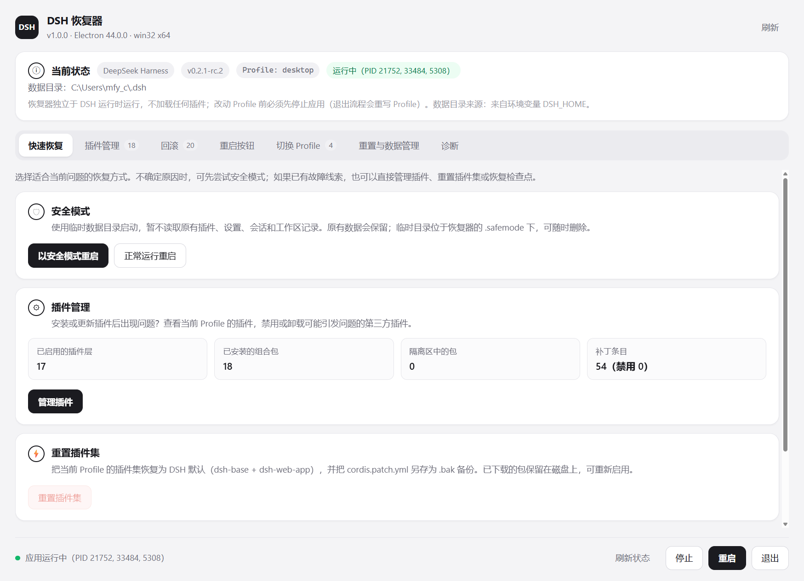
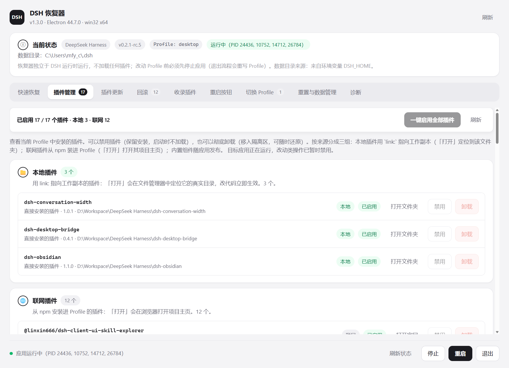
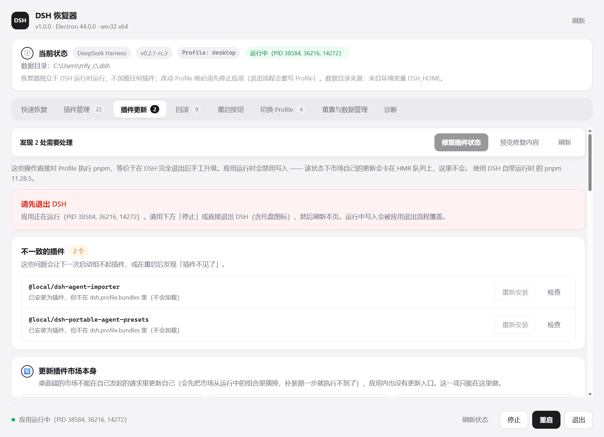
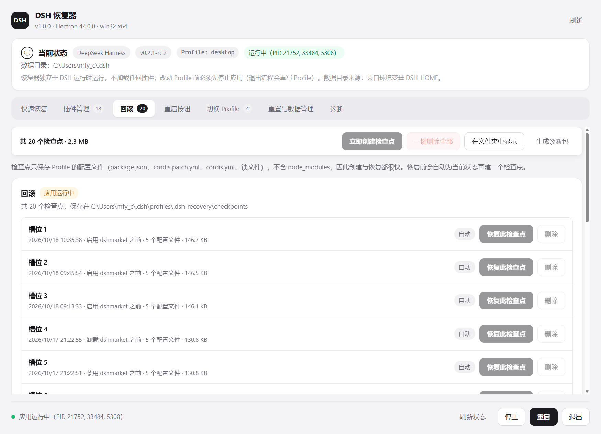
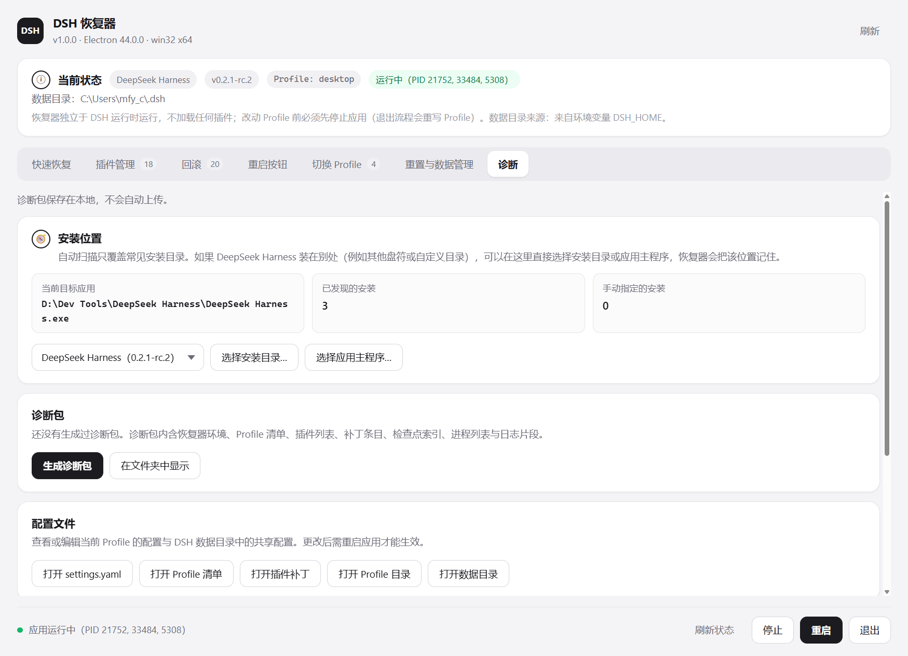
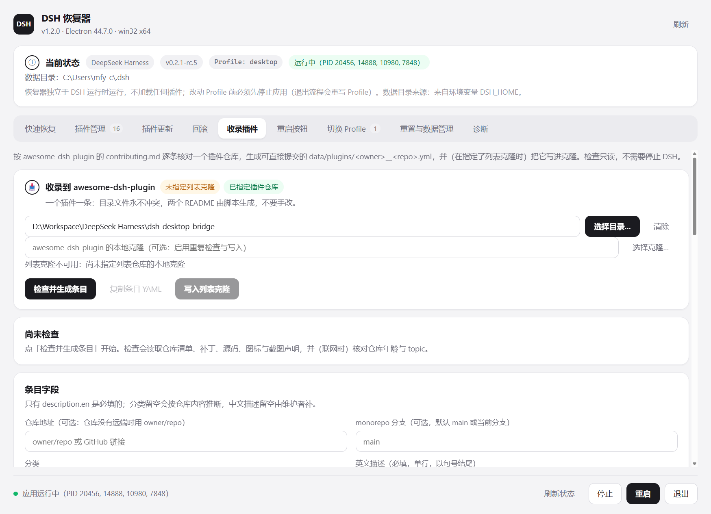

# DSH 恢复器（dsh-recovery）

一个**独立的桌面恢复控制台**，让 DeepSeek Harness 在无法正常启动时仍然可以被修复。
九个标签页：快速恢复 / 插件管理 / **插件更新** / 回滚 / **收录插件** / 重启按钮 / 切换 Profile / 重置与数据管理 / 诊断。



| 插件管理 | 插件更新 |
| --- | --- |
|  |  |

| 回滚 | 重启按钮 | 诊断 |
| --- | --- | --- |
|  |  |  |



## 为什么不做成 DSH 插件

DSH 插件只有在 DSH（以及它的 Profile）成功启动之后才会被加载。
既然要解决的问题正是「DSH 起不来」，恢复能力就必须位于 DSH **之外**：
本控制台使用自带的 Electron 运行时启动，`require` 的只有 Node 内置模块和 `electron`，
**不加载 DSH 运行时、任何 Profile 组合包或第三方模块**。

它因此是「第二个程序」，而不是「DeepSeek Harness 里的一个页面」。

## 快速开始

```bat
:: 启动（首次会自动准备运行时）
dsh-recovery.cmd

:: 在桌面创建快捷方式（带专属图标）
create-shortcut.cmd                 :: → 桌面「DSH 恢复模式.lnk」
create-shortcut.cmd 我的恢复模式    :: → 自定义名称

:: 只准备 / 刷新运行时（在安装或升级 DeepSeek Harness 之后运行）
setup-runtime.cmd

:: 列出识别到的应用安装目录
setup-runtime.cmd --list

:: 无窗口自检：跑完整的读取链路并打印摘要，全部正常时退出码为 0
.runtime\dsh-recovery.exe --self-check

:: 无窗口端到端自检：在一次性 fixture 上真实执行禁用/卸载/检查点/启动/停止
.runtime\dsh-recovery.exe --verify

:: 无窗口界面自检：真的开一次窗口、点开「重启按钮」页签、断言页签/桥接口/按钮状态并截图
.runtime\dsh-recovery.exe --ui-check              :: 截图默认写 .runtime\ui-restart-tab.png
.runtime\dsh-recovery.exe --ui-check --ui-shot=D:\shot.png
```

> 这三条自检在 PowerShell 里要**先清掉 `ELECTRON_RUN_AS_NODE`**
> （DSH 会把它注入子进程环境，值为 `1` 时 Electron 会以纯 Node 模式启动，
> 把 `--verify` 当成自己的未知开关并报 `bad option: --verify`）：
>
> ```powershell
> Remove-Item Env:\ELECTRON_RUN_AS_NODE -ErrorAction SilentlyContinue
> Start-Process .\.runtime\dsh-recovery.exe -ArgumentList '--verify' `
>   -RedirectStandardOutput verify.json -RedirectStandardError verify.err.txt `
>   -PassThru -Wait -NoNewWindow
> ```
>
> `dsh-recovery.cmd` 已经替你做掉这一步，直接双击运行不受影响。

启动参数（同时会被记住到 `dsh-recovery.config.json`）：

| 参数 | 说明 |
| --- | --- |
| `--target=<目录或 id>` | 目标应用，例如 `--target="D:\Dev Tools\DeepSeek Harness"` 或 `--target=deepseek-harness` |
| `--profile=<名称>` | 要操作的 Profile，默认 `desktop` |
| `--home=<目录>` | DSH 数据目录，默认取环境变量 `DSH_HOME`，否则 `%USERPROFILE%\.dsh` |

## 九个标签页

| 页面 | 能力 |
| --- | --- |
| 快速恢复 | 以**安全模式**启动（临时环境，不读原有插件/设置/会话，退出后自动清理）；正常启动；跳转插件管理；重置插件集；打开 Profile / 插件补丁 / 数据目录 / 检查点目录 |
| 插件管理 | 按**来源分组**（本地插件 / 联网插件 / 内置组件），每行可直接打开：本地插件定位到它的工作副本文件夹，联网插件打开项目主页；按行启用/禁用组合包（写入 `package.json` 的 `dsh.profile.bundles`）；**一键启用全部插件**（并解除补丁层 `disabled: true`）；卸载到**隔离区**并可还原；只读列出「其他依赖」与补丁条目 |
| 插件更新 | 直接对**已停止的 Profile** 执行 pnpm：安装 / 升级 / 卸载 / 单包校验；**修复插件状态**（清僵死写入锁与运行记录、让插件层与磁盘一致）；解析市场日志说明上次操作卡在哪。用于绕开应用内「更新卡在 remove」与「市场不能更新自己」两个宿主缺陷，详见下文 |
| 回滚 | 列出检查点（槽位）、创建、恢复、删除；**一键删除全部检查点**；每个检查点记录插件清单、组合包列表、补丁和被禁用的行 |
| **收录插件** | 按 [awesome-dsh-plugin](https://github.com/awesome-dsh-plugin/awesome-dsh-plugin) 的 `contributing.md` 逐条核对插件仓库，生成可直接提交的 `data/plugins/<owner>__<repo>.yml`；「必须修正」可**一键复制给 AI 修改**；指定列表克隆后还能查重并写入。**只读**，不需要停止 DSH。规则与流程见 [docs/awesome-plugin-submission.md](docs/awesome-plugin-submission.md) |
| 重启按钮 | 给官方 `app.asar` 安装/校验/还原**「重启」菜单补丁**（菜单栏「应用」「编辑」右侧多一个「重启」，内含刷新页面 / 重启应用与 Host / 重启到恢复模式）；显示两个条目的判定、头部 integrity 与备份状态 |
| 切换 Profile | 列出可用 Profile（插件数/补丁数），切换当前 Profile；「新建 Profile」交由 DSH 自身的初始化流程完成 |
| 重置与数据管理 | 查看/更改 DSH 数据目录、恢复默认；**恢复出厂设置**（把当前数据目录移入回收站并重启） |
| 诊断 | 「安装位置」卡：**手动选择安装目录或应用主程序**（自动扫描未覆盖时可指定，可切换、可移除）；导出诊断包（日志 + Profile 配置，本地保存、不上传）、在文件夹中显示、打开 `settings.yaml` / Profile 清单 / 插件补丁 / Profile 目录 |

### 手动指定安装位置

自动扫描只覆盖 `%LOCALAPPDATA%`、`%ProgramFiles%`、`D:\Dev Tools` 等常见根目录下的一层子目录。
装在别处（其他盘符、绿色版、自定义目录）时，在**诊断 → 安装位置**里点：

- **选择安装目录…** —— 选应用目录即可，恢复器会读取其中的 `resources\app.asar` 与主程序；
- **选择应用主程序…** —— 直接选那个 `.exe`，会自动反推它所在的安装目录；
- 已有的手动位置可以切换（下拉框）或**移除此手动指定的安装**；自动发现的安装不能被移除。

接受的位置是「包含 `resources\app.asar`（或 `resources\app\package.json`）与主程序的目录」——
传 `resources` 子目录或 exe 路径也能反推回安装目录；不符合时报错并说明需要什么，
不会写入配置。选择结果保存进 `dsh-recovery.config.json` 的 `targets`，下次启动照旧生效。
这三条动作也进了 `--verify`（8 项检查），且用 `persist: false` 在内存里跑，
真实配置文件前后按字节比对不变。

### 插件更新：为什么需要这一页

DSH Desktop 的应用内更新有两个**宿主侧**缺陷，都定位到了具体代码：

1. **更新卡在 `remove`**。`@deepseek-ai/dsh-plugin-manager` 的 `removeBundle()` 先跑 pnpm
   （几秒就成功、包已被删掉），再调 `configure()` → `hmr.runExclusive()`。那条队列是
   `this.operations = task.catch(() => {})`：**没有超时、没有取消**。队首一旦不结算
   （某个插件 fiber 在 `stopPlanned()` 的 `fiber.await()` 上不返回），后面所有人都永久排队 ——
   包括同一次更新的 `add`、下一次更新、插件页开关、以及市场自己的 `withMutationLock`。
   界面于是停在「正在移除…」，而重启后插件已经没了。
2. **市场不能更新自己**。`dshmarket` 的 `installOrReinstall()` 里有
   `if (SELF_NAMES.has(name)) return { code: 'market-self-update' }`：桌面端 remove 会先把市场
   从运行的组合里摘掉，补装那一步的代码已经不在了。应用内「设置 → 插件」也没有更新入口。

两者共同的规避方式只有一个：**让包变更发生在 DSH 完全退出之后**。这一页就是它的按钮版：

| 动作 | 做的事 |
| --- | --- |
| 修复插件状态 / 预览修复内容 | 清掉 `<profile>/package.json.lock` 与 `.plugin-manager/run.json`（仍被活进程持有的保留）；补回被宿主丢掉的 `dsh.profile.bundles` 条目；删掉指向已不存在包的条目；**绝不删 `@deepseek-ai/*` 自带组件** |
| 升级 / 安装 / 卸载 | 用安装目录自带的 pnpm 执行 `add`/`remove`（带 `--config.minimum-release-age=0`，否则新版本会被发布等待期挡住）；装完**补回插件层条目**并校验入口文件 |
| 检查 | 单包验收：依赖声明、插件层条目、入口文件、补丁文件是否存在 |
| 上次操作卡住了 | 读 `.dsh-market/log.ndjson` 与 `.plugin-manager/logs/*/pnpm.log`：若日志已写 `Done in …s`，就说明卡点在 pnpm 之后的宿主重组 |

安全边界（在 `backend/ipc.js` 里强制，不依赖界面）：

- 应用运行中**禁止写入**，面板顶部直接显示「请先退出 DSH」；
- 每个写入动作前**自动创建检查点**；
- 「升级一个没装的包」「空包名」这类前提错误在**建检查点之前**就拒绝；
- 读不到 manifest 的 Profile 不会让整页崩掉，错误作为数据展示。

对应实现：`app/backend/plugin-updater.js`（Engine，零依赖、可离线工作）。
同一套逻辑另有一个命令行版本 `../dsh-plugin-doctor/`，供不想开图形界面的场景使用。

### 两个「一键」操作

两个长列表页面顶部都有一条**常驻操作条**（`.pbar`，随面板滚动吸顶），不必滚到列表末尾：

- **插件管理 → 一键启用全部插件**：把该 Profile 允许加载的组合包一次性写进
  `package.json` 的 `dsh.profile.bundles`（一次落盘）。规则与单行「启用」完全一致：
  核心件必启用；组合包必须同时出现在 `dependencies` 中且声明了 `dsh.bundle.patch`；
  其余包**跳过并逐条说明原因**（例如 `fake-dep: 不是插件组合包`）。
  只列在 `bundles` 里还不够——补丁层写 `disabled: true` 的条目同样不会被加载，所以
  这条动作**还会把 `cordis.patch.yml` 里所有 `disabled: true` 改成 `false`**：只替换
  `disabled:` 这一行的标量，缩进、注释、`config.enabled` 与其它字段逐字节保持不变，
  原文件的换行风格（LF/CRLF）也照原样拼接回去；改写了哪几条会写进结果消息。
  已全部启用且补丁层无禁用时按钮禁用；重复执行不会产生任何写入；执行前自动创建检查点。
- **回滚 → 一键删除全部**：逐个删除槽位（含自动检查点与恢复前快照），被占用的槽位
  **不会中断整批**，而是记录在失败列表里一并汇报；同时显示释放的空间。
  空列表时按钮禁用、重复执行返回「没有可删除的检查点」；只删快照，不动 Profile 当前内容。

两条动作都有确认框（列出受影响的包名 / 槽位数量与占用空间），并各自进了 `--verify` 与 `--ui-check`。

### 「重启按钮」页签

它管理的是**在 DSH 壳本体上加一个「重启」菜单**的补丁（实现与命令行工具在
`restart-button\`，详见 `restart-button\README.md`）：

- 改写目标是当前目标应用的 `resources\app.asar` 里的 `lib/main.js` 与 `lib/preload-app.cjs`；
- 两个条目都做**等长原地改写**（长度与偏移完全不变，只同步头部的 integrity 哈希串），
  因此**应用正在运行时安装或还原都是安全的**，重启 DeepSeek Harness 后生效；
- 页签里的三个按钮 = `安装补丁`（已安装时禁用）/ `校验内容` / `还原补丁`（未安装且无备份时禁用），
  并在「补丁工具」卡里给出工具目录、状态文件、备份目录、载荷文件的路径与打开入口；
- 底部会保留**上一次运行**的日志（安装/还原/校验），便于排查。

## 三种自检

| 命令 | 覆盖范围 | 是否改动磁盘 |
| --- | --- | --- |
| `--self-check` | 只读链路：目标探测、Profile 清单与补丁解析、检查点列表、运行状态 | 完全不写 |
| `--verify` | 全部写操作：插件启用/禁用/**一键启用全部（含补丁层 disabled 解除）**/卸载/还原/永久删除、**插件来源分类（本地/联网/内置）与「打开」目标解析**、检查点创建/恢复/删除/**一键删除全部**、**手动指定/移除安装位置**（含无效目录拒绝）、安全模式启动、停止（精确匹配进程）、诊断包导出 | 只写一次性 fixture 与 `.safemode\`，结束前自清理 |
| `--ui-check` | 真开窗口渲染一遍界面：页签数量与名称、`window.recovery` 桥接口、两个「一键」按钮的存在与禁用态、**诊断页「安装位置」按钮**、**插件行「打开」按钮与来源标签**、**页脚在未运行/运行中两种状态下的按钮组合**（防 `undefined` 文字）、点开「重启按钮」页签后的活动面板与按钮可用性，并截图（含快速恢复 / 插件管理 / 插件更新 / 回滚 / 诊断五张附加截图） | 只写截图 |

`--verify`（54 项检查）在每次运行时构造一个合成环境 `\.runtime\verify-<时间戳>\`：
一份假的安装目录（`resources\app\package.json` 声明为 `@deepseek-ai/dsh-desktop`）和一份假的
Profile，然后用**内存里的** `config` 指向它去跑真实动作，因此：

- 不读、不写真实的 DSH 数据目录，也不写 `dsh-recovery.config.json`（前后按字节比对）；
- 唯一被读取的真实文件是官方 `resources\app.asar`：运行前后各算一次 sha256 并断言相等，
  以此证明所有动作都没有碰过官方安装目录（读取必须绕过 Electron 的 asar 补丁，见 `app/backend/asar.js`）；
- 结束时校验「退出」这一路真的终止了进程（4 秒内未退出即判失败）；
- fixture、临时安全模式目录、以及本次导出的诊断包都会被删除。

任一项失败时退出码非 0，并打印每条检查的 `ok`/`detail`。

## 安全设计

- **应用运行中拒绝一切 Profile 改动**：目标应用退出时会重写 Profile，此时改动会被覆盖。
  控制台检测所有 `DeepSeek Harness.exe` 进程，只把不含 `--type=` 的那个当作主进程展示。
- **卸载 = 移入隔离区**（`profiles\<名称>\.dsh-recovery\removed\<时间戳>-<包名>`），可以还原或永久删除。
- **改 Profile 之前自动创建检查点**，检查点位于 `profiles\.dsh-recovery\checkpoints\<id>`。
- 写入使用临时文件 + 原子替换；配置损坏时回退到默认值而不会让控制台失效。
- 卸载 DSH 插件前校验它是组合包（`dsh.bundle.patch`）且确实在 Profile 依赖中，避免误删。

## 目录结构

```
dsh-recovery/
  dsh-recovery.cmd        启动器（缺运行时先调 setup-runtime.cmd）
  create-shortcut.cmd     在桌面创建带图标的快捷方式（可传自定义名称）
  setup-runtime.cmd       准备运行时的包装脚本
  setup-runtime.js        从已安装的 DeepSeek Harness 硬链接出 Electron 运行时
  app/
    main.js               Electron 主进程（窗口、IPC 注册、--self-check / --verify / --ui-check）
    assets/               图标：icon.png（1024px，窗口用）+ icon.ico（16–256px 多尺寸，快捷方式用）
    preload.js            contextBridge：暴露 window.recovery.*
    backend/              零依赖后端（paths/profile/checkpoints/diagnostics/zip/launcher/asar/ipc/util/verify/restart-button）
    renderer/             原生 DOM 渲染界面（index.html / app.js / styles.css）
  tools/
    make-icon.py          重新生成 app/assets 下的 icon.png / icon.ico（Pillow）
  restart-button/         重启按钮补丁：lib/（asar + patch 库 + 载荷生成 + 命令行）、payload/、backup/、*.cmd
  .runtime/               生成的 Electron 运行时 + resources/app 目录联接 + userdata
                          以及 --ui-check 的截图（ui-restart-tab*.png，docs/ 里的图即由此导出）
  docs/                   README 用的界面截图
  diagnostics/            导出的诊断包（按需创建）
  dsh-recovery.config.json 记住的目标/Profile/数据目录
```

### 运行时是怎么来的

`setup-runtime.js` 把已安装应用目录里的 Electron 运行时（exe / dll / pak / locales）
**硬链接**到 `.runtime\`，再把 `.runtime\resources\app` 做成指向本仓库 `app\` 的**目录联接**。
不复制 200 MB 可执行文件，也不改动原安装目录。
因为硬链接共享内容，安装目录升级后重跑一次 `setup-runtime.cmd` 即可。

> 注意：`.runtime\resources\app` 是目录联接，**不要**用递归删除清理 `.runtime`
> （会顺着联接删掉 `app\`）。`setup-runtime.js` 自身只用「删单个文件 + `rmdir` 删联接点」。

## 已知限制

- 目前只在 Windows 上实现（进程枚举/停止用 PowerShell，目录联接用 junction）。
- 「新建 Profile」只提示由 DSH 自身初始化，不在控制台里代建。
- 诊断包导出的是日志与配置快照，不含崩溃内存转储。
- 控制台不加载 DSH 运行时，因此看不到插件加载的实时原因（那部分原因在应用日志里）。
- 自动扫描只找常见根目录下的一层子目录；装在别处需要用**诊断 → 安装位置**手动指定（见上）。

## 版本记录

### 2026-10-30 · v1.3.1 · 分组改称「联网插件」

- 「网上安装的插件」改名为 **「联网插件」**：与「本地插件」「内置组件」都是四个字，
  读起来对仗，也避免「网上」那种口语化的别扭感。行内标签同步从「网上安装」改为「联网」，
  顶部统计变成「本地 3 · 联网 12」。
- 只改显示文案与测试用例名，判定逻辑（`source: registry`）不变，
  因此无需重算任何数据。`--verify` 78/78、`--ui-check` ok 复跑通过。

### 2026-10-30 · v1.3.0 · 插件按来源分组

- 版本号 `1.2.0` → `1.3.0`。
- **修掉页脚的 `undefined`**：应用未启动时，页脚按钮行会多出一个字面的「undefined」。
  根因是 `renderFooter` 用原生 `ParentNode.append()` 拼装按钮，未运行状态传进去的
  「停止」按钮是 `undefined`，而原生 append 会把它字符串化成一个文本节点。改为
  `footerActions(running)` 返回具名对象（空项为 `undefined`），再交给本仓库会跳过空值的
  `append()` 辅助函数，从结构上排除了这种可能。
- **插件管理按来源分组**：`listPlugins` 新增 `source` / `sourcePath` / `linked` / `spec` /
  `homepage` / `installedPath`，判定依据是**依赖说明符与文件系统同时看**——
  `link:` / `file:` 说明符，或 `node_modules` 条目本身是指向别处的目录联接，都算本地插件
  （工作副本可能被换成联接，也可能联接目标已被删）。分组为：

  | 分组 | 判定 | 「打开」行为 |
  | --- | --- | --- |
  | 本地插件 | `link:` / `file:` 或联接 | 在文件管理器中定位**真实目录**（联接目标） |
  | 联网插件 | 其余已安装包 | 浏览器打开 `homepage`，缺失则回退 `repository` |
  | 内置组件 | `@deepseek-ai/dsh-base` / `dsh-web-app` | 定位 Profile 内的安装副本 |

- 每行都有「打开文件夹 / 打开官网」按钮，目标在**主进程**里按插件名查表决定，
  渲染器只传包名——因此按钮不会被指向任意路径或任意 URL，`assertOpenable()` 的白名单不必放宽。
- **顺带修掉一个真实缺陷**：`util.removeEntry()` 遇到 Windows 目录联接时，
  `fs.rmSync(link, { force: true })` 会抛 `ERR_FS_EISDIR`。这不只影响测试——
  用 `link:` 安装的插件（本机 3 个）**卸载会直接失败**。现在联接走 `unlinkSync`
  并回退 `rmdirSync`，只摘除重解析点，绝不递归进入链接目标（否则会删掉用户的源码）。
- 自检加固：`--ui-check` 新增页脚两种状态（未运行 / 运行中）的按钮断言，
  并对插件面板断言「每行恰好一个『打开』按钮且文案合法」「面板与页脚都不出现 undefined」。
  这条断言**验证过确实能抓 bug**：故意往 `footerActions` 注入一个 `"undefined"` 标签后，
  `--ui-check` 立即报 `页脚状态 false 的按钮为 刷新状态/undefined/启动/退出`。
- 三项自检：`--self-check` ok、`--ui-check` ok（9 页签、0 问题）、`--verify` **78/78**
  （新增 7 项：来源分类、本地插件真实目录、联网插件主页、本地「打开」定位文件夹、
  未知插件名被拒、无主页插件标记与明确报错）。

### 2026-10-30 · v1.2.0 · 适配 DSH 0.2.1-rc.5

- 版本号 `1.1.0` → `1.2.0`（`app/package.json` 与 `restart-button/lib/patch.cjs` 的
  `TOOL_VERSION` 同步）。
- 官方把桌面壳从 **0.2.1-rc.3** 换到 **0.2.1-rc.5**：`resources\app.asar` 整体替换为
  182766714 B（上游原始 sha256 `e1b6f25f…`），重启按钮补丁随之丢失。
  新版 `lib/main.js` 仍是 516716 B、`lib/preload-app.cjs` 仍是 41075 B，偏移全部不变。
- 源码差异只有一处 —— `desktopClientVersion()` 里的 `"0.2.1-rc.3"` → `"0.2.1-rc.5"`，
  正好 2 个字符等长，所以按键同长度原地改写的老办法继续成立；`preload-app.cjs` 一字未动。
- 新增 `restart-button\lib\extract.cjs`：升级后一条命令把新的未打补丁
  `lib/main.js` / `lib/preload-app.cjs` 解到 `..\.dsh-src\lib\`（`build-payload.cjs` 的默认基线）。
  以前这一步是临时脚本，现在留在仓库里，且自带 `process.noAsar = true`（在恢复器里也能跑）。
- 重新生成载荷：`lib/main.js` = `839f7757be61f00f549253…`，
  `lib/preload-app.cjs` 不变 = `e42784d0f4c072af…`。旧的 rc.3 备份已归档到
  `restart-button\backup\v021-rc3-2026-10-24T05-36-02\`，根备份换成本次 rc.5 原始字节。
- 恢复器自带的 Electron 运行时也重新从 rc.5 安装目录硬链接（Electron 44.0.0 → **44.7.0**，
  Node 24.21.0 / Chrome 152.0.7977.130）；`--self-check` ok（目标识别为 0.2.1-rc.5）、
  `--ui-check` ok（9 页签、0 问题）、`--verify` **71/71**。
- 整包往返复测（在 asar 副本上）：`revert` → 上游原始 `e1b6f25f…` → `apply` → 回到 `66d7ff28…`，
  0 失败，大小恒为 182766714 B。
- 一处待查的噪声：本次第一次 `--verify` 报过一次「不变性: 控制台配置未被改写」失败。
  失败发生在本次会话早期，当时 `dsh-recovery.config.json` 里 `awesomeRepoDir` 的旧值
  （`dsh-conversation-width`）被换成新值；此后该文件 212 B、mtime `2026-10-30 11:36:56` 起未再变动，
  随后连跑 3 次 `--verify` 都是 **71/71**。`--verify` 内部对配置只做 `persist: false` 的内存改动，
  所以这次写入更可能来自同时开着界面的那一轮，而不是验证本身；结论是**config 现在稳定，验证全过**。

### 2026-10-26 · v1.1.0 · 收录插件页

- 版本号 `1.0.0` → `1.1.0`（`app/package.json` 与 `restart-button/lib/patch.cjs` 的
  `TOOL_VERSION` 同步；页签标题栏与「诊断 → 运行环境」读的就是这个值）。
- 新增第九个页签「收录插件」：按
  [contributing.md](https://github.com/awesome-dsh-plugin/awesome-dsh-plugin/blob/main/contributing.md)
  逐条核对插件仓库，生成可直接提交的 `data/plugins/<owner>__<repo>.yml`。
- 引擎 `app/backend/awesome.js`：零依赖。18 条规则分成**自动判定**（manifest / 补丁 / 有效代码行 /
  描述格式 / 分类 / 命名 / 图标 / 截图 / 条目数 / 聚合包 / peer 范围 / 依赖归属）、**联网判定**
  （仓库年龄、`dsh-plugin` topic、维护状态）与**人工项**（描述与代码一致、源码可疑性）。
  离线或 GitHub API 限流时降级为「未知」告警，绝不误判为失败。
- 「必须修正」卡片带**复制给 AI 修改**与**复制问题清单**两个按钮：内容由引擎在检查时一并生成
  （`fixesText`），保证复制出去的与屏幕上的完全一致；不含插件源码，修的人自己读仓库。
- 指定列表克隆后可查重并**原子写入**条目；同名但内容不同时**拒绝覆盖**，除非明确允许
  （只用于更新自己那一条）。页签**只读**：不停止 DSH、不改 Profile、不建检查点。
- 手册 [docs/awesome-plugin-submission.md](docs/awesome-plugin-submission.md)：给执行者（人或 AI）的
  逐步流程、字段规则、常见退回原因与处置。
- 修掉三个缺陷：
  - `--ui-check` 原本在 `ready` promise 内部运行，而所有 IPC 通道都 `await ready`，
    渲染器第一次 `status()` 调用会与检查互相等待（死锁），现改由 `whenReady` 在 `ready` 之后启动；
  - **仓库身份识别**：`parseRepoRef` 把 `git+ssh://`、`ssh://`、`git@host:owner/repo` 都当成
    本地路径，导致明明有远端却报「仓库没有 GitHub 远端」；同时 git 调用在
    「dubious ownership」的仓库上静默失败，现按次传 `safe.directory`，
    并在 git 读不到时回退到 `package.json` 的 `repository`/`homepage`；
  - 没填 `description.en` 时曾直接判失败（用户只是还没输入），现改为把 `package.json` 里现成的
    描述作为**草稿告警**提示，并提供「用 package.json 的描述填入」一键写入；仍不会自动采用。
- 三项自检全过：`--self-check` ok、`--ui-check` ok（9 页签、0 问题）、`--verify` 71/71。

### 2026-10-25 · 重装重启按钮补丁 + 桌面图标

- 线上 `app.asar` 已回到官方 rc.3 原始字节（`04b32e3a…`），补丁在应用升级后丢失。
  用恢复器 `restart-button\lib\apply.cjs apply` 重新写入两个条目，未改长度与偏移，
  回读整包 sha256 回到补丁态 `f99c48fc…`（182434783 B 不变），页签显示「已安装 2/2」。
- 新增恢复器自己的图标 `app/assets/icon.{png,ico}`（深色圆角方块 + 琥珀色重启环形箭头），
  由 `tools/make-icon.py` 用 Pillow 生成：1024px PNG 给窗口/标题栏，
  16–256px 多尺寸 ICO 给桌面快捷方式；32px 下仍可辨认。
- `app/main.js` 给 `BrowserWindow` 设 `icon`（文件缺失时自动跳过，绝不因图标挡住启动）。
  注意 `.runtime\dsh-recovery.exe` 是官方主程序的**硬链接**，改动它等于改官方安装，
  所以图标只挂在窗口与快捷方式上。
- `create-shortcut.cmd` 改为优先用 `app/assets/icon.ico`，并支持 `--no-pause`；
  参数改为逐个解析（`%1` 为空时不再吞掉 `%2`）。桌面已创建「DSH 恢复模式」快捷方式。
- 三项自检全过：`--self-check` ok、`--ui-check` ok（8 页签、0 问题）、`--verify` 54/54。

### 2026-10-24 · 适配 DSH 0.2.1-rc.3

- 官方更新把 `app.asar` 换成 182434783 字节的新版本（上游整包 sha256
  `04b32e3a872826ba15cfb2081c6a929a8d4ecaa65e09a2543e5a6b30e2eff1f0`），补丁随之丢失。
  这次 rc.2 → rc.3 的 `lib/main.js` **只差一行**（`desktopClientVersion()` 里的版本字符串），
  条目长度仍是 516716 / 41075 字节，所以载荷重建后依旧**等长原地改写**，asar 大小与偏移不变。
- 按新源码（`.dsh-src\lib-v021-rc3`）重新生成载荷，sha256：
  `lib/main.js` = `5c79faddeac5069cae58abfc94225632cdaf9f55176751b14e81efb04af83fa2`，
  `lib/preload-app.cjs` = `e42784d0f4c072af03f78b2aba02ade4c6ed81609ae30e8320b67b3647116992`（未变）。
  补丁态整包 sha256 = `f99c48fc450f726584c49bce9524edb729aead84eb3bcd1f10245712e3155157`。
- 旧备份归档到 `restart-button\backup\v021-rc2-2026-10-24T05-35-10-047Z\`；副本往返
  （`revert` → 上游 `04b32e3a…` → `apply` → 回到 `f99c48fc…`）0 失败，`--verify` 仍 54 项全过。

### 2026-10-18 · 手动指定安装位置

- 诊断页新增「安装位置」卡：**选择安装目录… / 选择应用主程序…**，可切换、可移除手动指定的位置；
  `adoptTarget` 接受安装目录、`resources` 子目录或 exe 路径，无效位置报错且不写配置。
- 快速恢复页在「未找到目标应用」时也提供这两个入口。
- `--verify` 增至 **42 项**（新增 8 项目标解析检查），`--ui-check` 增断言与第 4 张截图。

### 2026-10-18 · 适配 DSH 0.2.1-rc.2

- 官方更新把 `app.asar` 换成 182794869 字节的新版本，旧补丁随之丢失；按新源码
  （`.dsh-src\lib-v021-rc2`）重新生成载荷：`lib/main.js` 490173 → **516716** 字节，
  `lib/preload-app.cjs` 仍 41075 字节，依旧**等长原地改写**，asar 大小与所有偏移未变。
- 新载荷 sha256：`lib/main.js` = `1bc3a7b9dee72cf93c924a14ac8dc79d63990ad7c7b6f18267211047509209d6`，
  `lib/preload-app.cjs` = `e42784d0f4c072af03f78b2aba02ade4c6ed81609ae30e8320b67b3647116992`。
- 升级后重打补丁的**正确顺序**：先搬走旧的 `restart-button\backup\`（否则会保留旧版本的
  "首份备份"，`revert` 因长度不符失败），再 `build-payload.cjs --write`，最后 `apply.cjs apply`。

### 2026-10-18 · 一键启用全部插件 / 一键删除全部检查点

- 两个长列表页顶部各加一条**吸顶操作条**（列表再长也不用滚到底）。
- 「一键启用」会同时把 `cordis.patch.yml` 里所有 `disabled: true` 改成 `false`
  （只替换该行标量，缩进/注释/`config.enabled` 与换行风格原样保留）。

### 2026-10-21 · 插件更新页（绕开卡在 remove 与市场不能自我更新）

- 新增第八个页签「插件更新」：对**已停止的 Profile** 直接执行 pnpm 的 install/update/remove，
  并提供「修复插件状态」（清僵死 `package.json.lock` 与 `.plugin-manager/run.json`、
  让 `dsh.profile.bundles` 与磁盘一致）与市场日志解析（判断上次是卡在 pnpm 还是卡在 HMR）。
- 引擎 `app/backend/plugin-updater.js`：零依赖，只用 Node 内置模块，Profile 起不来时也能工作。
- 安全边界在 IPC 层：应用运行中禁止写入；写入前自动建检查点；前提错误（升级未安装的包、
  空包名）在建检查点之前拒绝；manifest 读不出来时错误作为数据展示而不是让整页崩掉。
- `--verify` 增至 **54 项**（新增 12 项插件更新检查，含「拒绝后 profile 未被改动」与
  「修复不碰 `@deepseek-ai/*` 自带组件」），`--ui-check` 增至 **8 个页签**并新增第 5 张截图。

### 2026-10-06 · 首个版本

- 七个标签页、独立 Electron 运行时、三种自检、重启按钮补丁（界面 + 命令行）。

