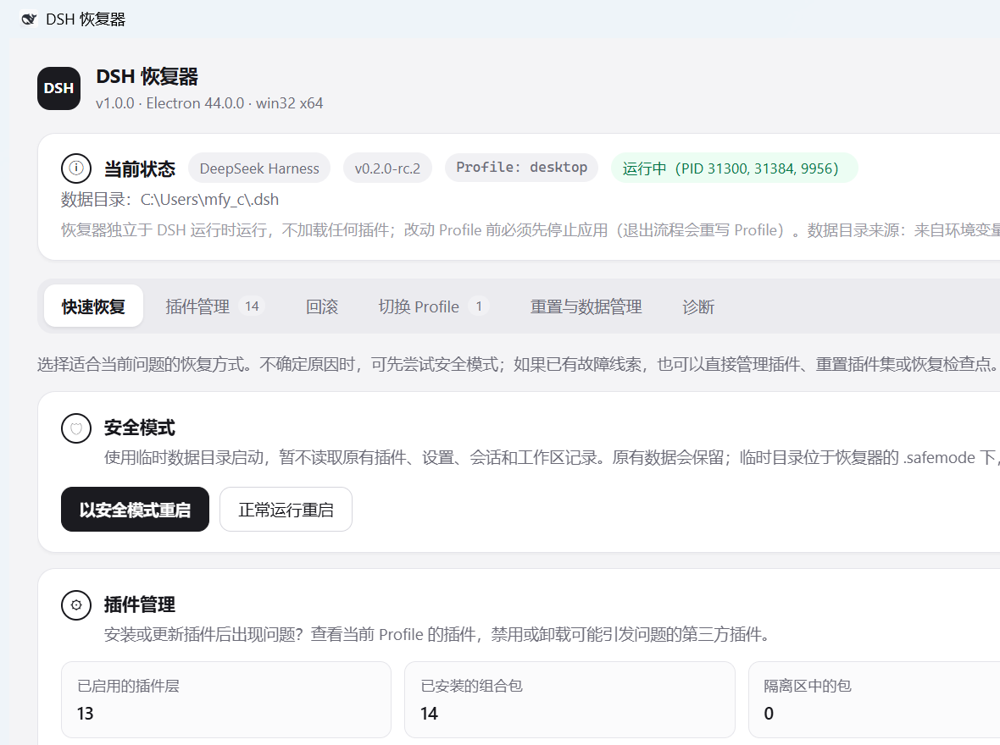

# DSH 恢复器（dsh-recovery）

一个**独立的桌面恢复控制台**，让 DeepSeek Harness 在无法正常启动时仍然可以被修复。
界面与能力对标 `DSH Desktop` 的恢复模式（七个标签页：快速恢复 / 插件管理 / 回滚 /
重启按钮 / 切换 Profile / 重置与数据管理 / 诊断）。



## 为什么不做成 DSH 插件

DSH 插件只有在 DSH（以及它的 Profile）成功启动之后才会被加载。
既然要解决的问题正是「DSH 起不来」，恢复能力就必须位于 DSH **之外**：
本控制台使用自带的 Electron 运行时启动，`require` 的只有 Node 内置模块和 `electron`，
**不加载 DSH 运行时、任何 Profile 组合包或第三方模块**。

它因此是「第二个程序」，而不是「DeepSeek Harness 里的一个页面」。

## 快速开始

```bat
:: 启动（首次会自动准备运行时）
dsh-recovery.cmd

:: 只准备 / 刷新运行时（在安装或升级 DeepSeek Harness 之后运行）
setup-runtime.cmd

:: 列出识别到的应用安装目录
setup-runtime.cmd --list

:: 无窗口自检：跑完整的读取链路并打印摘要，全部正常时退出码为 0
.runtime\dsh-recovery.exe --self-check

:: 无窗口端到端自检：在一次性 fixture 上真实执行禁用/卸载/检查点/启动/停止
.runtime\dsh-recovery.exe --verify

:: 无窗口界面自检：真的开一次窗口、点开「重启按钮」页签、断言页签/桥接口/按钮状态并截图
.runtime\dsh-recovery.exe --ui-check              :: 截图默认写 .runtime\ui-restart-tab.png
.runtime\dsh-recovery.exe --ui-check --ui-shot=D:\shot.png
```

启动参数（同时会被记住到 `dsh-recovery.config.json`）：

| 参数 | 说明 |
| --- | --- |
| `--target=<目录或 id>` | 目标应用，例如 `--target="D:\Dev Tools\DeepSeek Harness"` 或 `--target=deepseek-harness` |
| `--profile=<名称>` | 要操作的 Profile，默认 `desktop` |
| `--home=<目录>` | DSH 数据目录，默认取环境变量 `DSH_HOME`，否则 `%USERPROFILE%\.dsh` |

## 七个标签页

| 页面 | 能力 |
| --- | --- |
| 快速恢复 | 以**安全模式**启动（临时环境，不读原有插件/设置/会话，退出后自动清理）；正常启动；跳转插件管理；重置插件集；打开 Profile / 插件补丁 / 数据目录 / 检查点目录 |
| 插件管理 | 按行启用/禁用组合包（写入 `package.json` 的 `dsh.profile.bundles`）；**一键启用全部插件**（并解除补丁层 `disabled: true`）；卸载到**隔离区**并可还原；只读列出「其他依赖」与补丁条目 |
| 回滚 | 列出检查点（槽位）、创建、恢复、删除；**一键删除全部检查点**；每个检查点记录插件清单、组合包列表、补丁和被禁用的行 |
| 重启按钮 | 给官方 `app.asar` 安装/校验/还原**「重启」菜单补丁**（菜单栏「应用」「编辑」右侧多一个「重启」，内含刷新页面 / 重启应用与 Host / 重启到恢复模式）；显示两个条目的判定、头部 integrity 与备份状态 |
| 切换 Profile | 列出可用 Profile（插件数/补丁数），切换当前 Profile；「新建 Profile」交由 DSH 自身的初始化流程完成 |
| 重置与数据管理 | 查看/更改 DSH 数据目录、恢复默认；**恢复出厂设置**（把当前数据目录移入回收站并重启） |
| 诊断 | 导出诊断包（日志 + Profile 配置，本地保存、不上传）、在文件夹中显示、打开 `settings.yaml` / Profile 清单 / 插件补丁 / Profile 目录 |

### 两个「一键」操作

两个长列表页面顶部都有一条**常驻操作条**（`.pbar`，随面板滚动吸顶），不必滚到列表末尾：

- **插件管理 → 一键启用全部插件**：把该 Profile 允许加载的组合包一次性写进
  `package.json` 的 `dsh.profile.bundles`（一次落盘）。规则与单行「启用」完全一致：
  核心件必启用；组合包必须同时出现在 `dependencies` 中且声明了 `dsh.bundle.patch`；
  其余包**跳过并逐条说明原因**（例如 `fake-dep: 不是插件组合包`）。
  只列在 `bundles` 里还不够——补丁层写 `disabled: true` 的条目同样不会被加载，所以
  这条动作**还会把 `cordis.patch.yml` 里所有 `disabled: true` 改成 `false`**：只替换
  `disabled:` 这一行的标量，缩进、注释、`config.enabled` 与其它字段逐字节保持不变，
  原文件的换行风格（LF/CRLF）也照原样拼接回去；改写了哪几条会写进结果消息。
  已全部启用且补丁层无禁用时按钮禁用；重复执行不会产生任何写入；执行前自动创建检查点。
- **回滚 → 一键删除全部**：逐个删除槽位（含自动检查点与恢复前快照），被占用的槽位
  **不会中断整批**，而是记录在失败列表里一并汇报；同时显示释放的空间。
  空列表时按钮禁用、重复执行返回「没有可删除的检查点」；只删快照，不动 Profile 当前内容。

两条动作都有确认框（列出受影响的包名 / 槽位数量与占用空间），并各自进了 `--verify` 与 `--ui-check`。

### 「重启按钮」页签

它管理的是**在 DSH 壳本体上加一个「重启」菜单**的补丁（实现与命令行工具在
`restart-button\`，详见 `restart-button\README.md`）：

- 改写目标是当前目标应用的 `resources\app.asar` 里的 `lib/main.js` 与 `lib/preload-app.cjs`；
- 两个条目都做**等长原地改写**（长度与偏移完全不变，只同步头部的 integrity 哈希串），
  因此**应用正在运行时安装或还原都是安全的**，重启 DeepSeek Harness 后生效；
- 页签里的三个按钮 = `安装补丁`（已安装时禁用）/ `校验内容` / `还原补丁`（未安装且无备份时禁用），
  并在「补丁工具」卡里给出工具目录、状态文件、备份目录、载荷文件的路径与打开入口；
- 底部会保留**上一次运行**的日志（安装/还原/校验），便于排查。

## 三种自检

| 命令 | 覆盖范围 | 是否改动磁盘 |
| --- | --- | --- |
| `--self-check` | 只读链路：目标探测、Profile 清单与补丁解析、检查点列表、运行状态 | 完全不写 |
| `--verify` | 全部写操作：插件启用/禁用/**一键启用全部（含补丁层 disabled 解除）**/卸载/还原/永久删除、检查点创建/恢复/删除/**一键删除全部**、安全模式启动、停止（精确匹配进程）、诊断包导出 | 只写一次性 fixture 与 `.safemode\`，结束前自清理 |
| `--ui-check` | 真开窗口渲染一遍界面：页签数量与名称、`window.recovery` 桥接口、两个「一键」按钮的存在与禁用态、点开「重启按钮」页签后的活动面板与按钮可用性，并截图（含插件管理 / 回滚两张附加截图） | 只写截图 |

`--verify`（34 项检查）在每次运行时构造一个合成环境 `\.runtime\verify-<时间戳>\`：
一份假的安装目录（`resources\app\package.json` 声明为 `@deepseek-ai/dsh-desktop`）和一份假的
Profile，然后用**内存里的** `config` 指向它去跑真实动作，因此：

- 不读、不写真实的 DSH 数据目录，也不写 `dsh-recovery.config.json`（前后按字节比对）；
- 唯一被读取的真实文件是官方 `resources\app.asar`：运行前后各算一次 sha256 并断言相等，
  以此证明所有动作都没有碰过官方安装目录（读取必须绕过 Electron 的 asar 补丁，见 `app/backend/asar.js`）；
- 结束时校验「退出」这一路真的终止了进程（4 秒内未退出即判失败）；
- fixture、临时安全模式目录、以及本次导出的诊断包都会被删除。

任一项失败时退出码非 0，并打印每条检查的 `ok`/`detail`。

## 安全设计

- **应用运行中拒绝一切 Profile 改动**：目标应用退出时会重写 Profile，此时改动会被覆盖。
  控制台检测所有 `DeepSeek Harness.exe` 进程，只把不含 `--type=` 的那个当作主进程展示。
- **卸载 = 移入隔离区**（`profiles\<名称>\.dsh-recovery\removed\<时间戳>-<包名>`），可以还原或永久删除。
- **改 Profile 之前自动创建检查点**，检查点位于 `profiles\.dsh-recovery\checkpoints\<id>`。
- 写入使用临时文件 + 原子替换；配置损坏时回退到默认值而不会让控制台失效。
- 卸载 DSH 插件前校验它是组合包（`dsh.bundle.patch`）且确实在 Profile 依赖中，避免误删。

## 目录结构

```
dsh-recovery/
  dsh-recovery.cmd        启动器（缺运行时先调 setup-runtime.cmd）
  setup-runtime.cmd       准备运行时的包装脚本
  setup-runtime.js        从已安装的 DeepSeek Harness 硬链接出 Electron 运行时
  app/
    main.js               Electron 主进程（窗口、IPC 注册、--self-check / --verify / --ui-check）
    preload.js            contextBridge：暴露 window.recovery.*
    backend/              零依赖后端（paths/profile/checkpoints/diagnostics/zip/launcher/asar/ipc/util/verify/restart-button）
    renderer/             原生 DOM 渲染界面（index.html / app.js / styles.css）
  restart-button/         重启按钮补丁：lib/（asar + patch 库 + 载荷生成 + 命令行）、payload/、backup/、*.cmd
  .runtime/               生成的 Electron 运行时 + resources/app 目录联接 + userdata
                          以及 --ui-check 的截图（ui-restart-tab*.png）
  diagnostics/            导出的诊断包（按需创建）
  dsh-recovery.config.json 记住的目标/Profile/数据目录
```

### 运行时是怎么来的

`setup-runtime.js` 把已安装应用目录里的 Electron 运行时（exe / dll / pak / locales）
**硬链接**到 `.runtime\`，再把 `.runtime\resources\app` 做成指向本仓库 `app\` 的**目录联接**。
不复制 200 MB 可执行文件，也不改动原安装目录。
因为硬链接共享内容，安装目录升级后重跑一次 `setup-runtime.cmd` 即可。

> 注意：`.runtime\resources\app` 是目录联接，**不要**用递归删除清理 `.runtime`
> （会顺着联接删掉 `app\`）。`setup-runtime.js` 自身只用「删单个文件 + `rmdir` 删联接点」。

## 已知限制

- 目前只在 Windows 上实现（进程枚举/停止用 PowerShell，目录联接用 junction）。
- 「新建 Profile」只提示由 DSH 自身初始化，不在控制台里代建。
- 诊断包导出的是日志与配置快照，不含崩溃内存转储。
- 控制台不加载 DSH 运行时，因此看不到插件加载的实时原因（那部分原因在应用日志里）。
