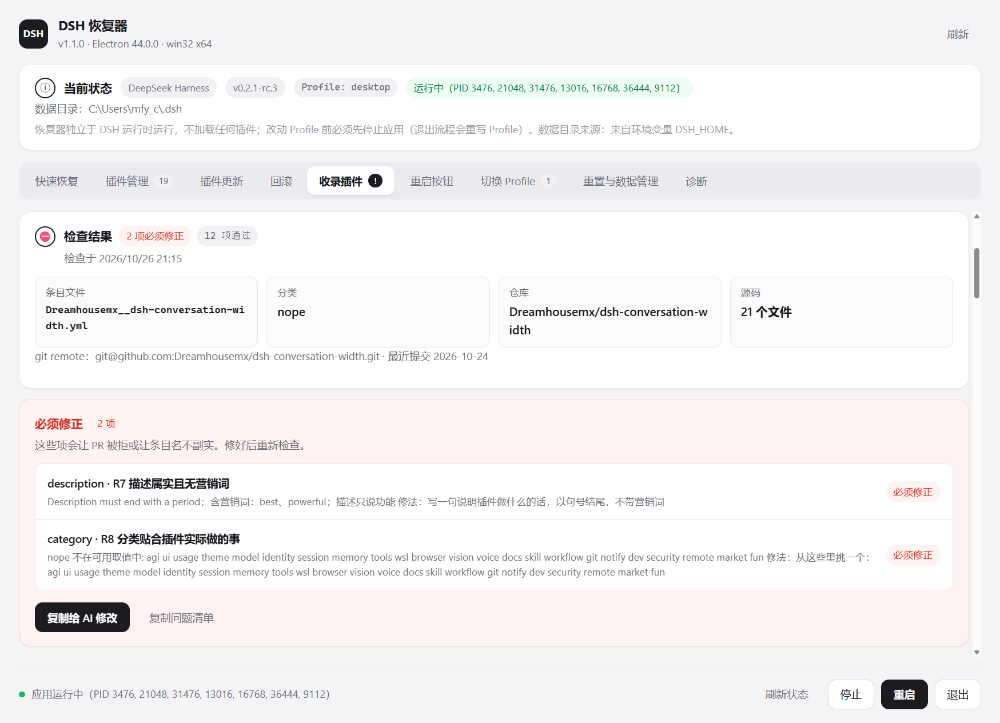

# 收录插件到 awesome-dsh-plugin —— 执行手册

> 这份文档写给**执行者**，而不是读者：无论你是人还是 AI，照着从上往下做，就能把一个插件仓库收录进
> [awesome-dsh-plugin](https://github.com/awesome-dsh-plugin/awesome-dsh-plugin) 列表，并且知道
> 每一步**为什么**要做、**失败时**怎么办。
>
> 规则来源：上游 [`contributing.md`](https://github.com/awesome-dsh-plugin/awesome-dsh-plugin/blob/main/contributing.md)
> （2026-10 版本）。上游会变；**规则以该文件为准，这份手册是它的可执行化版本**。发现不一致时，
> 先看上游，再回来改这份文档和 `app/backend/awesome.js` 里的检查。
>
> 自动化入口：DSH 恢复器的「收录插件」页签（见[第 9 节](#9-用恢复器面板执行可选但省事)），
> 引擎在 [`app/backend/awesome.js`](../app/backend/awesome.js)。

---

## 0. 三十秒版

列表的数据源是 `data/plugins/` 下的**一个插件一个 YAML 文件**，两个 README 由脚本生成。
所以收录一个插件 = **新增一个文件** `data/plugins/<owner>__<repo>.yml`，内容五个字段：

```yaml
url: https://github.com/owner/repo
name: owner/repo
category: ui
description:
  en: One-line description ending with a period.
  zh: 一句话描述，以句号结尾。
```

前置条件（不满足就会被 CI 或维护者打回）：

1. `package.json` 声明了 `dsh.bundle`（只声明 `dsh.client` 不行）；
2. 仓库里有真实可用的代码；
3. 仓库创建满 1 天；
4. 仓库带 `dsh-plugin` topic；
5. 描述只讲功能、不含营销词、**与代码一致**；
6. 分类贴合插件实际做的事。

一个 PR 最多 3 条。**不要手工编辑 README。**

---

## 1. 为什么是一个文件

以前所有人往同一个 README 分类的同一位置追加，合并一个 PR 就撞掉下一个。现在每个插件一个文件，
文件永不冲突；两个 README 从 `data/plugins/*.yml` 生成，在 PR 合并后于 `main` 上自动重建。

推论（会反复用到）：

- 投稿 PR 的 diff **只有一个新增文件**；
- 想预览自己那一行长什么样，可以在本地 `npm ci && node scripts/generate-readme.mjs`，
  提交生成结果也接受，但**必须与数据源一致**；
- 更新自己的条目时，改**自己的那个 yml** 再重新生成，不要碰 README 的行。

---

## 2. 入口文件的命名

| 情形 | 文件名 | `url` | `name` |
| --- | --- | --- | --- |
| 普通仓库 | `<owner>__<repo>.yml` | `https://github.com/owner/repo` | `owner/repo` |
| monorepo 子包 | `<owner>__<repo>--<子包路径用 - 连接>.yml` | 指向子目录的 tree URL | `owner/repo#<子包名>` |

例：`https://github.com/owner/repo/tree/main/packages/my-plugin`
→ 文件名 `owner__repo--packages-my-plugin.yml`，`name: owner/repo#my-plugin`。

`url` **必须与仓库完全一致**（不是 fork、不是镜像、不是自己的转存）。文件名由它推出，
两者不一致会让人找不到你的文件。

---

## 3. 字段规则

### 3.1 必填

`url`、`name`、`category`、`description.en`。**只有 `description.en` 是唯一必须写的描述**——
写不了中文就留空，维护者会补；缺翻译不是打回理由。

### 3.2 `category` 取值

```
agi ui usage theme model identity session memory tools wsl browser vision voice
docs skill workflow git notify dev security remote market fun
```

选择原则：**贴着插件实际做的事**，不是你想让它出现在哪。选得不准**不会**被打回——维护者会直接改。
分类体系本身也在演进（`usage`/`vision` 从别处拆出来，`security`/`browser`/`git`/`docs`/`remote`/`voice`
也是），今天的最佳归类以后可能被重新归档。挑最接近的，不要纠结。

几个容易放错的：

- **主题 / 皮肤** → `theme`（会进市场的主题 Tab，一键安装/切换/卸载），**不要**放 `ui`；
- 会话交接、上下文压缩、历史归档 → `session`；
- 记忆、召回、向量检索 → `memory`；
- 调试、诊断、日志、构建辅助 → `dev`；
- 插件市场本身、索引、安装器 → `market`。

### 3.3 `description.en` / `description.zh`

- **单行**，以句号结尾（中文可用「。」）；
- 只说功能，不带营销词（best / amazing / revolutionary / 最强大 / 神器 / 极致 …）；
- **必须属实**：它是你对插件的声明，会被拿去和代码核对。写「46 个工具、六大领域」就要真有
  46 个工具和六大领域；提到某个命令或 API，它就必须存在。**夸大是让一个本来不错的插件被打回的主因。**

⚠️ **描述里出现 `: `（冒号加空格）必须加引号**，否则 YAML 会把它读成嵌套键：

```yaml
description:
  en: 'Vision toolkit: OCR, grounding and pixel diff.'   # ✅
  zh: '识图工具包：OCR、定位与像素比对。'                    # 中文全角冒号无此问题，加引号也无妨
```

```yaml
  en: Vision toolkit: OCR, grounding and pixel diff.      # ❌ 解析失败
```

### 3.4 `icon`（可选）

一张 **GitHub 托管的位图**：`png` / `jpg` / `jpeg` / `webp`。约 96px 显示，方形最好。
不写就回退作者头像。**SVG 与第三方图床会被拒绝**（列表不让访客去不可担保的图床取图）。

### 3.5 `tarball`（可选，但源码装不上时必需）

预构建包，必须是 **GitHub Release 上的 https `.tgz`**。

⚠️ `latest/download/` 只在请求时解析 `latest`，**文件名是照字面取的**。资产名带版本号时，
提交当天有效，你下次发版就 404，而且没人会发现。二选一：

```yaml
# 资产名不带版本号
tarball: https://github.com/owner/repo/releases/latest/download/plugin.tgz
# 或者钉住 release tag（这里带版本号反而是正常写法）
tarball: https://github.com/owner/repo/releases/download/v1.2.0/plugin-1.2.0.tgz
```

### 3.6 不要写的字段

- `npm:` —— 手写会被校验拒绝。npm 映射从 registry 自动采集，
  前提是**已发布包的 `repository` 字段指回本列表收录的那个仓库**。发不发 npm 都不影响收录。

---

## 4. 前置条件逐条核对

### R2 `dsh.bundle` manifest（最常见的被拒原因）

可安装的定义就是这个字段。**只声明 `dsh.client` 无法用 `dsh plugin add` 安装。**

```jsonc
{
  "dsh": {
    "bundle": { "patch": "./cordis.patch.yml" },   // ← 必须
    "client": { "platform": "web" }                 // 只有带前端 UI 时才需要
  }
}
```

并在仓库根放一个 `cordis.patch.yml`：

```yaml
- insert:
    - id: your-plugin-id
      name: your-package-name
```

monorepo 的根包**或**子包声明了都算数。

### R3 补丁文件

`dsh.bundle.patch` 指向的文件必须**存在**，并且真的 `insert` 了东西——一个只 `disable` 不 `insert`
的补丁等于没有行为。纯运行时入口（无补丁）的插件可以只声明入口。

### R4 真实可用的代码

占位仓库、name-squat、纯 README 仓库不收。检查器会数**有效代码行**（剔除空行与注释），
十行以下按占位处理。

### R5 仓库创建满 1 天

由 CI 自动检查。**没有提交数门槛**（历史长短反映开发习惯，不反映质量）。
这条只为过滤「PR 前几分钟才建好」的仓库——如果暂时不够，把功能做完再提交，重新提交不受任何影响。

### R6 `dsh-plugin` topic

在 GitHub 仓库页面添加 topic `dsh-plugin`。少了这一项 CI 会失败。

### R18 活跃维护

定期扫描会标记仓库消失、已归档、长期停更的条目，汇总到一个跟踪 issue，确认后移除。
收录不是永久的。

### R14 不是纯聚合包（重要）

**收插件，不收聚合包。** 内容只有一份依赖清单、自己不带任何行为的聚合包**不单独收录**：
它装上一组别的插件，一行只指向别的行，对读者没有增量信息，还会让同一份工作在它涉及的
每个分类里被重复计数。

判定要点：

- 聚合包自己**做事**（合成配置、提供设置界面、运行时协调各部分）→ 它就是插件，按普通标准审；
- 聚合包只是依赖清单 → 分别收录依赖里的**单个插件**；
- 聚合包本身可以继续发布、用户可以继续装，只是不占列表的一行。

### R15 依赖指向原作者

聚合包的依赖必须解析到**原作者的仓库或其发布的 npm 包**。把别人的插件重新上传到自己账号下、
再依赖这些副本，不予收录——副本没有 fork 关系、没有署名、没有上游，用户装到的是别人作品的
静默快照。这不是裁定谁写了什么；**把依赖直接指向上游即可解决**。

### R16 官方包用 `peerDependencies`，范围要带预发布分支

官方 `@deepseek-ai/*` 包声明为 `peerDependencies`，不是 `dependencies`。

⚠️ node-semver 只有当范围里**某个比较符与该版本的 `major.minor.patch` 元组完全一致、且自身也带
预发布标签**时，才放行预发布版本。所以看起来宽的范围也会静默排除 harness 的所有预发布构建：

```jsonc
// ❌ 看起来匹配一切，实际排除所有 0.1.0-* 预发布
"peerDependencies": { "@deepseek-ai/dsh-tools": ">=0.0.1-rc.1 <0.2.0" }

// ✅ 在匹配的元组上带显式预发布分支
"peerDependencies": { "@deepseek-ai/dsh-tools": ">=0.0.1-rc.1 <0.1.0 || >=0.1.0-rc.1 <0.2.0-0" }
```

有预发布分支的写法：每一段 `||` 分支都要自己带预发布比较符。

---

## 5. 截图（可选，推荐）

**在插件自己的仓库里声明**：`package.json` 旁边放 `screenshots.json`（monorepo 条目放在对应子目录），
列 1–8 张图片路径。

```jsonc
// <repo>/screenshots.json
[
  "assets/screenshot-1.png",
  "assets/screenshot-2.png"
]
```

也可以写成 `{"screenshots": [...]}`。规则：

- 1–8 张；
- 路径**相对于该文件**，不能跳出插件目录（不能以 `/` 开头、不能含 `..`）；
- 也接受绝对 URL，但必须是 **GitHub 托管的 https**（`raw.githubusercontent.com`、
  `user-images.githubusercontent.com`、`camo.githubusercontent.com`、`github.com` 附件），
  第三方图床会被拒绝；
- 不声明也能收录：市场会从 README 自动抽取——声明只是让你能控制顺序与展示内容。

**为什么放在自己的仓库**：换截图推自己的仓库即可，不用来提 PR；相对路径在改名时会立刻暴露；
没有人会动你的文件，截图投稿之间不会再互相冲突。

---

## 6. 提交过程

### 6.1 步骤

```bash
# 1. 分叉并克隆列表
git clone https://github.com/<you>/awesome-dsh-plugin
cd awesome-dsh-plugin

# 2. 新增唯一一个文件
#    data/plugins/<owner>__<repo>.yml  ← 内容见第 0 节

# 3.（可选）本地预览生成的 README
npm ci && node scripts/generate-readme.mjs

# 4. 提交并推送
git checkout -b add-<owner>__<repo>
git add data/plugins/<owner>__<repo>.yml
git commit -m "Add <owner>/<repo>"
git push origin add-<owner>__<repo>
```

然后开 PR。反馈会以 PR 评论给出，**明确指出要改什么**；推送修复到同一分支即可，不用重开 PR。

### 6.2 一个 PR 最多 3 条

超过 CI 直接拒绝并要求拆分。3 这个数字不是拍脑袋：设额度时最近 100 个已合并 PR 里 92 个加 1 条、
8 个加 2 条；2026-09-24 重数，88 个加 1 条、3 个加 2 条、9 个加 3 条。留这个余量是为了
monorepo 子包各自可独立安装这一种情形。

**如果多个插件都是你的，除了拆分还要挑。** 提交「只能留几个时会留下的」，不是「所有能跑的」。
读者打开一个分类需要的是「这些都值得一看」，不是「这里面有几个值得一看」。

### 6.3 CI 检查顺序

1. **条目数量** —— 每 PR 最多 3 条，最先检查，早于任何网络请求；
2. **`dsh.bundle`** —— 从仓库 `package.json`（根包，或 `packages/`·`plugins/`·`apps/` 子包）读取；
   只声明 `dsh.client` 在这里失败；
3. **仓库年龄** —— 1 天门槛；
4. **`awesome-lint` 与站点构建** —— 双语一致性、分隔符、日期、截图。

CI 通过是**前置条件，不是结论**。

---

## 7. 维护者实际会看什么（CI 覆盖不到）

CI 只校验形式：manifest、仓库年龄、格式、README 能否重新生成。它无法判断插件是否名副其实、
分类是否贴切、是否重复。合并前维护者会**实际读仓库**：

1. **代码是否与声明一致** —— 包括描述里的数字与 API 名称；
2. **分类是否合理** —— 不会因为分类打回，更贴切的直接改；
3. **是否真实可用的代码** —— 而非占位或空壳；
4. **是否已被现有条目覆盖** —— 做同一件事时先到者保留位置，但那只是平局排序，不是既得利益；
   收录不是永久的，停止维护/行为可疑/有明显缺陷的会被移除。**所以 fork 是可以收录的**——
   只要它维护得更好，或确实做了新东西。规则不是先来后到，是**谁更好**；
5. **源码里有没有可疑之处** —— 混淆代码、凭据外传、异常的安装期行为。收录**不等于**安全审查，
   这是常识检查，不是审计；
6. **是否动了与它无关的条目** —— 更新一个插件的 PR 不该改写另一个的描述。这类问题曾两次蒙混过关
   （#1348），因为机械检查全过了：YAML 合法、README 能生成、lint 干净。现在 gate 会列出 PR
   修改的每一个既有条目；
7. **是不是纯聚合包**（见 R14）；
8. **依赖是否指向原作者**（见 R15）。

**如果你只记一件事**：描述必须属实。被送回来改描述不是对插件的否定——改好那一行就能进。

---

## 8. 交付前自检清单

逐条打勾，任何一条不确定就先去确认：

- [ ] PR 只新增 **1 个** `data/plugins/*.yml`（或 monorepo 的 ≤3 个），没有改别人条目
- [ ] 没有手工编辑 `README.md` / `README.zh.md`
- [ ] `url` 与 GitHub 仓库**完全一致**，文件名由它推出
- [ ] `package.json` 声明了 `dsh.bundle`，且 `dsh.bundle.patch` 的文件真实存在并 `insert`
- [ ] 仓库有真实代码（不是占位/纯 README）
- [ ] 仓库创建满 1 天，带 `dsh-plugin` topic
- [ ] `description.en` 单行、以句号结尾、无营销词、**每一句都能在代码里找到对应**
- [ ] 描述里含 `: ` 时已加引号
- [ ] `category` 是列表中合法值，且贴合作品实际行为（主题类放 `theme`）
- [ ] `icon`（如有）是 GitHub 托管的 png/jpg/webp，不是 SVG、不是第三方图床
- [ ] `tarball`（如有）是 GitHub Release 上的 `https` `.tgz`，且文件名不会因发版 404
- [ ] 官方 `@deepseek-ai/*` 包在 `peerDependencies`，范围带显式预发布分支
- [ ] 不是纯聚合包；聚合包的依赖都指回原作者
- [ ] 已人工读过源码：无混淆、无凭据外传、无异常安装期行为

---

## 9. 用恢复器面板执行（可选，但省事）

DSH 恢复器 →「收录插件」页签把上面 1–8 节变成了按钮。它**只读**：不需要停止 DSH，不改 Profile，
不创建检查点。

### 9.1 两步

1. **插件仓库目录** → 选你要收录的仓库（monorepo 就选子包目录）；
2. 填「条目字段」（分类留空会按仓库内容推断），点 **检查并生成条目**。

结果会分成三组：

- **必须修正**（红）：会让 PR 被拒或让条目名不副实，逐条带「修法」；
- **需要人工确认**（黄）：检查器无法自动判定，或依赖网络信息；
- **已通过的检查**：记录实际读到的内容，便于复核。

底部给出可直接提交的 YAML、PR 说明、以及「评审会看什么」的人工清单。

### 9.2 把「必须修正」直接交给 AI



「必须修正」卡片右上角有两个复制按钮：

| 按钮 | 复制出去的内容 | 用在哪 |
| --- | --- | --- |
| **复制给 AI 修改** | 一段自包含的指令：仓库目录、仓库地址、条目文件名、**每一条失败规则**（问题 + 修法）、修改要求（只改相关文件、不许夸大描述、改完逐条说明）、规则来源链接 | 直接粘给 AI 编码助手，它照着读仓库就能修 |
| **复制问题清单** | 只有问题本身（规则 + 问题 + 修法） | 贴到 PR 评论、issue，或自己对着改 |

两点设计取舍：

- **不复制插件源码**。修的人自己读仓库就够了；把代码粘进对话只会拉长文本、还可能贴错版本。
- **两份内容都由引擎在检查时生成**（`fixesText`），所以复制出去的东西**永远和屏幕上的检查结果一致**，
  不会出现「显示 3 条、复制出 2 条」的错位。

复制完交给 AI 的典型用法：

```
（粘上「复制给 AI 修改」的内容）
```

AI 修完后，回到面板点「检查并生成条目」重新检查即可 —— 规则判定是本地跑的，不用重启任何东西。

### 9.3 可选的列表克隆

指定一个 `awesome-dsh-plugin` 的本地克隆后，额外得到：

- **重复检查** —— 列表里已有指向同一仓库的条目会提示；
- **写入条目** —— 把 `data/plugins/<file>.yml` 原子写入克隆；
  同名但内容不同时**拒绝覆盖**，除非明确勾选「允许更新已有条目」（只用于更新你自己的条目）。

### 9.4 检查器判定了哪些规则

| 规则 | 自动判定 | 依据 |
| --- | --- | --- |
| R1 一个文件 | 提示 | 流程说明 |
| R2 `dsh.bundle` | ✅ 失败 | 根包与 `packages/`·`plugins/`·`apps/` 子包 |
| R3 补丁 | ✅ 失败/告警 | 文件存在 + 含 `insert` |
| R4 真实代码 | ✅ 失败 | 有效代码行（剔除空行/注释）< 10 判占位 |
| R5 仓库年龄 | ✅ 联网 | GitHub API `created_at`，离线回退首次提交 |
| R6 topic | ✅ 联网 | GitHub API `topics` |
| R18 维护 | ✅ 联网 | 最近提交 / `pushed_at` 超过一年告警 |
| R7 描述 | ✅ 失败 | 单行、结尾标点、长度、营销词；数字与标识符列为待核实声明 |
| R8 分类 | ✅ 失败/建议 | 合法取值 + 按清单/关键词/README 推断 |
| R9 命名 | ✅ 失败 | `owner__repo[--path].yml` 与 `name` |
| R10 图标 | ✅ 失败 | https + GitHub 托管 + 位图 |
| R11 截图 | ✅ 失败 | 1–8 张、路径不越界、文件存在 |
| R12 条目数 | ✅ 失败 | > 3 |
| R13 重复 | ✅ 需克隆 | 规范化 URL 比对 |
| R14 聚合包 | ✅ 失败 | 只有 `dsh-*` 依赖且无自身行为 |
| R15 上游 | ✅ 告警 | 依赖指向他人账号的 GitHub 仓库 |
| R16 peer | ✅ 告警 | 官方包位置 + 预发布分支 |
| R17 README | 提示 | 流程说明 |

「联网」项在离线或 GitHub API 限流时降级为**告警（未知）**，不会误判为失败——
所以告警不是通过，仍然需要人（或 AI）确认。

### 9.5 卸载式核对（给 AI 的固定流程）

任何 AI 拿到一个候选插件仓库时，按这个顺序执行即可，无需读第二份文档：

```
1. 读 <repo>/package.json → 有 dsh.bundle 吗？patch 指向的文件在吗？里面有 insert 吗？
   只有 dsh.client → 停，先补 dsh.bundle。
2. 数有效代码行与文件 → 是否占位？只有 README → 停。
3. 看 dependencies：是否只由 dsh-* 依赖组成且自己没有代码/补丁 → 纯聚合包，停（改收单个插件）。
4. 看 peerDependencies：官方 @deepseek-ai/* 是否在此，范围是否每段 || 都带预发布比较符。
5. 看 screenshots.json（如有）→ 1-8 张，路径不越界。
6. 判断 category → 从 CATEGORIES 里挑最贴近实际行为的。
7. 写 description.en → 单行、句号结尾、无营销词；把它当成对代码的声明，逐句能指到代码。
8. 生成 data/plugins/<owner>__<repo>.yml → 字段顺序 url, name, category, description, icon, tarball。
9. 自检第 8 节的清单。
10. 若指定了列表克隆：比对是否重复；写入（同名不同内容须显式允许）。
11. 其余人工项（源码可疑性、描述与代码一致、分类贴合）必须真的看过，不能跳过。
```

---

## 10. 常见退回原因与处置

| 症状 | 原因 | 处置 |
| --- | --- | --- |
| CI: `dsh.bundle` 缺失 | 只声明了 `dsh.client` | 补 `dsh.bundle.patch` 与 `cordis.patch.yml` |
| CI: 仓库年龄 | 建库不足 1 天 | 完成工作后重新提交，不留记录 |
| CI: 条目数 > 3 | 一次塞太多 | 拆分，并挑最值得留的几个 |
| YAML 解析失败 | 描述含 `: ` 未加引号 | 加单引号 |
| 维护者: 描述与代码不符 | 夸大（数字、命令、API） | 改成代码支持的说法 |
| 维护者: 分类不合适 | 选了自己想出现的位置 | 换成贴合实际行为的（不会因此打回） |
| 维护者: 重复 | 已有条目覆盖同一功能 | 证明自己维护得更好或确实做了新东西（fork 可收录） |
| 维护者: 聚合包 | 只有依赖清单 | 改为分别收录单个插件 |
| 维护者: 依赖指向副本 | 依赖了自己转存的别人插件 | 依赖改回原作者仓库/npm 包 |
| 安装报 `ERESOLVE` | peer 范围静默排除预发布 | 加显式 `||` 预发布分支 |
| 图标不显示 | SVG / 第三方图床 | 换 GitHub 托管的 png/jpg/webp |
| `tarball` 下次发版 404 | 资产名带版本 + `latest/download/` | 去掉版本号或钉住 tag |
| 截图 404 | 写了别处的绝对 URL | 改成自己仓库里的相对路径 |

---

## 11. 维护这份文档

规则会变（分类会拆分、字段会新增）。改动时三处同步：

1. 上游 `contributing.md` —— 事实来源；
2. `app/backend/awesome.js` —— 检查实现（`RULES` 常量即规则清单）；
3. 这份文档 —— 给执行者的说明。

`--verify` 会跑覆盖这些规则的端到端用例（`收录:` 开头的检查项），改完跑一遍：

```bash
env -u ELECTRON_RUN_AS_NODE ./.runtime/dsh-recovery.exe --verify
```

---

**最后一句**：列表不是插件好坏的裁判，收录与否也不代表对作品的评价。规则只为一件事存在——
让打开页面的人，装上他挑中的插件后，它确实做描述里写的那件事。
