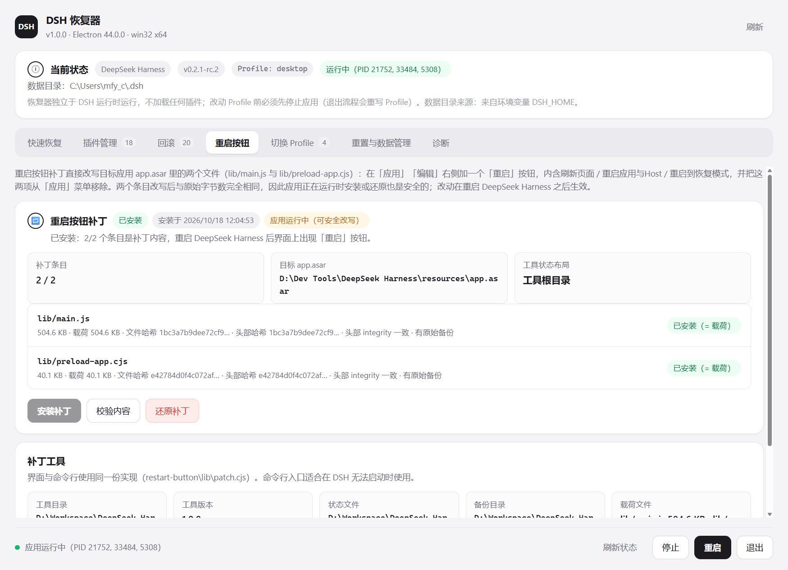

# 重启按钮补丁（`dsh-recovery\restart-button`）

> 原独立工具名 `dsh-restart-button-patch`，现已并入恢复器仓库，成为 `dsh-recovery\restart-button\`：
> 同一份实现既提供**恢复器界面里的「重启按钮」页签**（一键安装 / 校验 / 还原），
> 也保留下面这套**命令行入口**（DSH 完全起不来、连恢复器都不想开时用）。

给官方 **DeepSeek Harness** 桌面壳（`@deepseek-ai/dsh-desktop` 0.2.1-rc.2）的标题栏菜单栏
加一个 **「重启」** 按钮，位置在「应用」「编辑」右侧。

菜单结构变化（只动这两处）：

| 菜单 | 改前 | 改后 |
| --- | --- | --- |
| 应用 | … / 分隔线 / **刷新页面** / **重启应用与 Host** / 分隔线 / … | … / 分隔线 / 分隔线 / … |
| 编辑 | 撤销、重做、剪切、复制、粘贴、删除、全选 | 不变 |
| **重启**（新增） | — | **刷新页面** / **重启应用与 Host** / **重启到恢复模式** |

- 「刷新页面」「重启应用与 Host」原先是开发模式专属条目（`development ? [...] : []`），
  现在移出应用菜单、改由「重启」菜单提供，**在任何构建里都可见**。
- 「重启到恢复模式」是新条目：先拉起 **DSH 恢复器**（本工作区 `dsh-recovery`），成功后再退出 DSH；
  拉起失败时弹错误框并**保持 DSH 运行**，不会把应用关掉。
- 按钮文案复用现有本地化键：中文「重启」、英文 `Restart`。

## 快速开始

**方式一（推荐）：恢复器界面**。启动 `dsh-recovery.cmd`，切到「重启按钮」页签：
状态卡会显示两个条目的当前内容（已安装 / 未安装 / 内容未知）、头部 integrity 是否一致、
是否有原始备份，并提供**安装补丁 / 校验内容 / 还原补丁**三个按钮；「补丁工具」卡里还能直接
打开工具目录、状态文件与备份目录。安装成功后页签会显示「已安装 2/2」，并提示重启后生效。



**方式二：命令行**（本目录）：

```bat
cd "D:\Workspace\DeepSeek Harness\dsh-recovery\restart-button"
status.cmd     :: 只读：当前 asar 是原始内容还是补丁内容
install.cmd    :: 写入补丁（可在 DSH 运行中执行）
verify.cmd     :: 只读：回读两个条目、校验头部 integrity 与语法
revert.cmd     :: 还原为安装前的字节
```

安装后**重启 DeepSeek Harness**（或「应用 → 退出」再打开）即可看到「重启」按钮。

也可以直接调用：

```bat
node lib\apply.cjs status  [--archive <app.asar>]
node lib\apply.cjs verify  [--archive <app.asar>]
node lib\apply.cjs apply   [--archive <app.asar>] [--backup-dir <dir>] [--state <file>]
node lib\apply.cjs revert  [--archive <app.asar>] [--backup-dir <dir>] [--state <file>]
```

默认目标：`D:\Dev Tools\DeepSeek Harness\resources\app.asar`（可在 `config.cmd` 里用 `DSH_ASAR` 覆盖）。
恢复器界面不用这个默认值：它按自己解析出的目标应用，取 `<安装目录>\resources\app.asar`。

`lib\patch.cjs` 是库本体（界面与命令行共用），**所有函数都能在 Electron 里安全调用**：

```js
const patch = require("…\\dsh-recovery\\restart-button\\lib\\patch.cjs");
patch.status({ archive });   // 只读：条目内容判定 + 头部 integrity
patch.verify({ archive });   // 只读：integrity + 载荷比对 + node --check
patch.apply({ archive });    // 等长原地写入（可在应用运行时执行）
patch.revert({ archive });   // 用备份字节还原
```

- 备份/状态文件的落点由 `patch.pathsFor(archive)` 决定：默认归档走**工具根目录**（`backup\` +
  `state.json`）；其它路径的归档走**按目标归档**布局（`backup\<路径哈希前 12 位>\` +
  `state-<哈希>.json`），这样多个安装目录互不干扰。
- 在 Electron 进程里调用时，库自己会临时设置 `process.noAsar = true`：Electron 打过补丁的
  `fs` 会把任何含 `.asar` 的路径当成虚拟目录，不绕过就会 `ENOENT`。

## 为什么要「等长原地改写」

`app.asar` 的头部是一张 JSON 表，记录每个文件在归档里的 `offset` 与 `size`。
运行中的应用**只读一次头部**并缓存，之后按需用这些偏移懒读文件（Web 客户端分块、插件等）。

因此任何改变文件长度的写法都会平移后续所有条目，**正在运行的窗口会开始读到错位数据**；
新增文件同样会让头部 JSON 变长、平移全部偏移。本工具因此只做一件事：

> 用**长度完全等于头部 `size`** 的字节，原地覆盖 `lib/main.js`（516716 B）与
> `lib/preload-app.cjs`（41075 B），并把头部里这两个条目的 `integrity.hash` / `blocks[]`
> 哈希串替换为新内容的 sha256（同为 64 个十六进制字符，长度不变）。

结果是：**偏移、长度、头部结构全部不变**，所以可以在 DSH 运行中直接安装，
不会破坏当前会话，只需重启应用生效。

为了凑出「等长」，载荷还做了一点无害的取舍：删掉若干**纯文档 JSDoc 注释**
（`writeFileAtomic`、`DesktopHostProcess` 构造函数、`syncWindowFullscreen`、`installWindowsMenu`），
并用一行 `// dsh-restart-button-patch:====...`（README 指针）精确补齐剩余差量。
（这行字面量里的 `dsh-restart-button-patch` 是**已装进线上 asar 的载荷内容**，改名会让载荷哈希
与线上内容不再相等，所以刻意不改。）
`lib/build-payload.cjs` 会打印每一条的字节增量、断言每条替换**恰好命中一次**、断言最终长度等于目标长度。

## 载荷与源码

```bat
node lib\build-payload.cjs          :: 只报告：打印每条改动与字节差
node lib\build-payload.cjs --write  :: 生成 payload\lib\{main.js,preload-app.cjs} + payload\build.json
```

- 源码基线：`..\.dsh-src\lib\{main.js,preload-app.cjs}`（本工作区里保存的**未打补丁**解包副本，
  可用 `DSH_PATCH_SRC=<dir>` 覆盖）。当前这份基线是 **0.2.1-rc.2** 的
  `.dsh-src\lib-v021-rc2\`，官方再更新时同样要先解出新源码再指过去。
- 目标长度从 asar 头部实时读取，不写死；长度不符会直接报错中止。
- 生成的载荷已通过 `node --check`；当前载荷（0.2.1-rc.2）sha256：
  - `lib/main.js` → `1bc3a7b9dee72cf93c924a14ac8dc79d63990ad7c7b6f18267211047509209d6`
  - `lib/preload-app.cjs` → `e42784d0f4c072af03f78b2aba02ade4c6ed81609ae30e8320b67b3647116992`

## 改动内容（逐处）

`lib/main.js`

1. 删掉 `applicationItems()` 里的开发块（`...development ? [ 分隔线, 刷新页面, 重启应用与 Host ] : []`，−324 B）。
2. 新增 `RECOVERY_CONSOLE` / `launchRecoveryConsole()` / `restartItems()`（+1371 B）：

```js
const RECOVERY_CONSOLE = process.env.DSH_RECOVERY_CONSOLE
  ?? "D:\\Workspace\\DeepSeek Harness\\dsh-recovery\\.runtime\\dsh-recovery.exe";

const launchRecoveryConsole = () => new Promise((resolve) => {
  const env = { ...process.env };
  delete env.ELECTRON_RUN_AS_NODE;          // 否则 Electron 会以纯 Node 模式启动，窗口不出现
  const child = spawn(RECOVERY_CONSOLE, [], { detached: true, stdio: "ignore", env });
  child.once("error", (error) => { console.error("recovery console", error); resolve(false); });
  child.once("spawn", () => { child.unref(); resolve(true); });
});
```

  `restartItems()` 返回三项：`{ role: "reload" }`、`{ click: app.relaunch() + quitWithoutConfirmation() }`
  （与原开发块逐字相同）、`{ click: 拉起恢复器 → 成功才 quitWithoutConfirmation() }`。
3. `windowsMenu` IPC 白名单加入 `"restart"`，菜单项分支变为
   `name === "application" ? applicationItems() : name === "restart" ? restartItems() : [ …编辑项… ]`。
4. en/zh 文案各加 `restartRecoveryMenu`（`Restart into Recovery Mode` / `重启到恢复模式`）。

`lib/preload-app.cjs`

1. `const buttons = [createButton("application", 0), createButton("edit", 1), createButton("restart", 2)];`
   —— 第三颗按钮由同一套 shadow DOM 样式与 `windowsMenu` IPC 渲染，位于「编辑」右侧。
2. `buttons[2].textContent = messages.restartApplication;`（中文「重启」/ 英文 `Restart`）。
3. 左右方向键导航改为 `buttons[(index + 1) % buttons.length]`，三颗按钮间循环。

## 文件与状态

| 路径 | 说明 |
| --- | --- |
| `lib/asar.cjs` | 极简 asar 读写：pickle 头解析、条目定位、原地等长写入 + 头部哈希串同步 |
| `lib/patch.cjs` | **库本体**：`status` / `verify` / `apply` / `revert` + `pathsFor` 布局解析，带日志回调与 `withoutAsar()`；恢复器界面直接 require 它 |
| `lib/build-payload.cjs` | 由原始源码 + 编辑表生成等长载荷（可重复执行、可审计） |
| `lib/apply.cjs` | 上面那个库的 `status` / `verify` / `apply` / `revert` 命令行外壳 |
| `lib/inspect.cjs`、`lib/list.cjs`、`lib/find-slack.cjs` | 侦查工具：列 asar 条目、看条目 sha256/integrity、找可裁剪的注释块 |
| `payload/lib/*`、`payload/build.json` | 生成好的载荷字节与其哈希 |
| `backup/*.orig`、`backup/manifest.json` | **安装前**两个条目的原始字节（516716 + 41075 ≈ 545 KB），`revert` 的来源 |
| `state.json` | 最近一次 `apply` 的记录（时间、哈希、头部哈希串更新处数） |
| `config.cmd`、`install.cmd`、`status.cmd`、`verify.cmd`、`revert.cmd` | 命令行入口（自动查找 node，`DSH_ASAR` 可覆盖目标） |

`revert` 之后整包会**逐字节**回到安装前状态（见下）。

## 已验证的事实

1. **等长**：载荷长度 516716 / 41075，与头部 `size` 完全一致；`apply` 对长度不符的情况直接中止，
   且在写任何字节之前完成备份。
2. **可逆（整包级别）**：在 asar **副本**上做 `revert` → `apply` → `verify`，
   两次改写各动 2 个条目，最后整包 sha256 与操作前**完全相同**：
   - 副本来自当前线上补丁态整包 `a906284c15ab108e25c66a58b3e0f8d70cde9dae13269c3184cac83b5168b0f5`（182794869 B）；
   - `revert`（touched 2）→ 得到官方原始整包 `47874618bf5b3011fcaac10cd4c85f69da333e70d4f99b921207c78d0999512a`；
   - `apply`（changed 2）→ 又回到 `a906284c…`，`verify` failures 0；副本与临时文件随后删除。
   早期版本（0.2.0-rc.2）上也做过同样的 `apply → verify → revert` 往返，当时复原到
   `3f5cc17f99209f36799a373e0741d4890dbc384d2020877cd2755d9305c4e3a7`；
   并入恢复器后又用**界面按钮走的同一套代码**（`app\backend\restart-button.js`）复测过一遍。
3. **头部自洽**：两个条目的 `integrity.hash` 与 `blocks[0]` 都被同步为新内容哈希，
   回读校验为「头部 integrity 与内容一致（1 块）」，`node --check` 通过。
4. **语义核对**：`git diff --no-index ..\.dsh-src\lib\<file> payload\lib\<file>` 的 8+5 个 hunk
   与上面的改动清单逐行一致（除此之外没有别的差异）。
5. **恢复器启动方式**：用独立 Node 探针按 `launchRecoveryConsole` 的完全相同参数
   （`detached`、`stdio:"ignore"`、删除 `ELECTRON_RUN_AS_NODE`）拉起 `.runtime\dsh-recovery.exe`，
   进程与窗口（标题「DSH 恢复器」）正常出现 —— 该探针环境里 `ELECTRON_RUN_AS_NODE=1` 确实被继承，
   所以那行 `delete` 是必需的。
6. **本机已安装**：`apply` 已写入线上 asar，`status` 报「已安装（= 载荷）」，
   恢复器页签显示「已安装 2/2 · 头部 integrity 一致 · 有原始备份」。
7. **界面自检**：恢复器带 `--ui-check`，会真的开一次窗口、点开「重启按钮」页签，
   断言七个页签、桥接口、活动面板文案与按钮可用状态，然后截图退出（见 `dsh-recovery\README.md`）。

## 注意

- **必须重启 DSH 才生效**：`lib/main.js` / `lib/preload-app.cjs` 只在启动/建窗时读取。
  重启会结束当前这个会话（我运行在 DSH 内部），所以最终效果需要你重启后确认。
- **官方更新会覆盖 asar**：DSH Desktop 升级后 `resources\app.asar` 会被替换，补丁消失，需要重打。
  正确顺序（本机 0.2.0-rc.2 → 0.2.1-rc.2 时踩过）：
  1. 解出官方新的 `lib/main.js`、`lib/preload-app.cjs` 到 `.dsh-src\lib-v<版本>\`；
  2. **先把旧的 `backup\` 整目录搬走**——`apply` 只保留"首份备份"，留着旧版备份会让 `revert` 因长度不符失败；
  3. `set DSH_PATCH_SRC=<新目录>` 后跑 `node lib\build-payload.cjs --write`（长度从新头部读，不符会报错中止）；
  4. `node lib\apply.cjs apply`，再 `status` / `verify` 确认。asar 大小与偏移全程不变。
- **请用本工具的 `revert.cmd`**，不要用 `dsh-restart-menu-patch\revert.cmd`：后者会把 asar
  回滚到更早的原始构建，连「重启」按钮一起抹掉。
- 安装/还原只改 `resources\app.asar` 里这两个条目（外加它们头部的哈希串），
  不触碰装机目录里的其它文件；`app.asar.dsh-restart-backup`（旧工具的整包备份）保持不动。
- 恢复器路径可用环境变量 `DSH_RECOVERY_CONSOLE` 覆盖（在 DSH 的进程环境里设置）。
- 仅针对本机这个版本（`@deepseek-ai/dsh-desktop` 0.2.1-rc.2，asar 182794869 B，
  条目 lib/main.js 516716 B / lib/preload-app.cjs 41075 B）。
